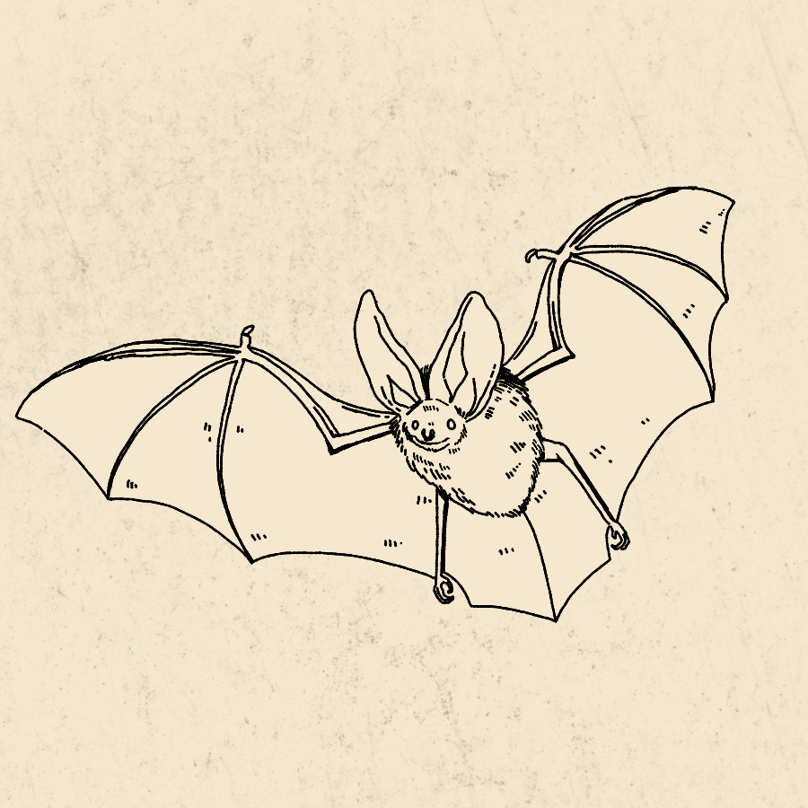
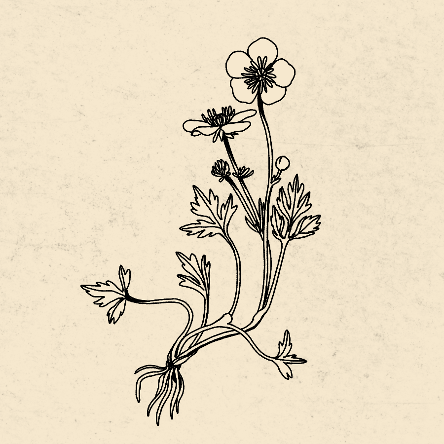
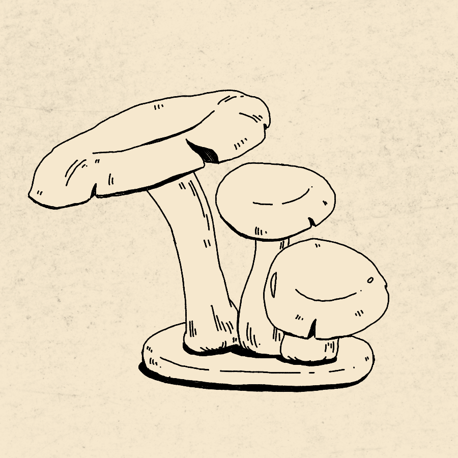
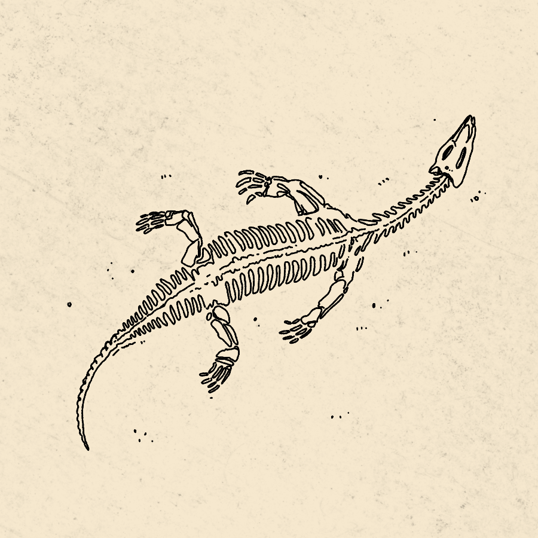

# Overview

Biological collections comprise specimens of animals, plants and fungi, while palaeontological collections preserve fossils of organisms from Earth’s past. Together with archaeobiological collections, they provide essential reference material for identifying, describing and naming species, and for understanding their evolution and ecological interactions.

These collections constitute a unique archive of life on Earth, documenting biodiversity and its changes over time. They also serve as biobanks, preserving biological and genetic material for future research. Beyond taxonomy and systematics, they are invaluable resources for research in fields such as climate change, biodiversity conservation, environmental monitoring, invasive species, human health and sustainable agriculture.

# In Switzerland
Swiss institutions hold nearly 60 million biological and palaeontological specimens, representing an extraordinary wealth of biodiversity from Switzerland and around the world. The SwissNatColl portal provides free access to data on more than 3 million of these specimens, with new records continuously being added.

Explore specimens across four domains:

    <a href="/specimen/search?view=table&taxonKey=1" style="text-decoration: none;" target="_blank">
      <button style="padding: 10px 20px; font-size: 24px; border: 2px solid white; border-radius: 4px; background-color: transparent; color: #333; cursor: pointer; display: flex; flex-direction: column; align-items: center; gap: 6px;"
              onmouseover="this.style.color='{{ site.data.colors.siteColor.background }}';"
              onmouseout="this.style.color='#333';">
        
        Zoology
      </button>
    </a>
    <a href="/specimen/search?view=table&taxonKey=6" style="text-decoration: none;" target="_blank">
      <button style="padding: 10px 40px; font-size: 24px; border: 2px solid white; border-radius: 4px; background-color: transparent; color: #333; cursor: pointer; display: flex; flex-direction: column; align-items: center; gap: 6px;"
              onmouseover="this.style.color='{{ site.data.colors.siteColor.background }}';"
              onmouseout="this.style.color='#333';">
        
        Botany
      </button>
    </a>
    <a href="/specimen/search?view=table&taxonKey=5" style="text-decoration: none;" target="_blank">
      <button style="padding: 10px 40px; font-size: 24px; border: 2px solid white; border-radius: 4px; background-color: transparent; color: #333; cursor: pointer; display: flex; flex-direction: column; align-items: center; gap: 6px;"
              onmouseover="this.style.color='{{ site.data.colors.siteColor.background }}';"
              onmouseout="this.style.color='#333';">
        
        Mycology
      </button>
    </a>
    <a href="/specimen/search?view=table&basisOfRecord=FOSSIL_SPECIMEN" style="text-decoration: none;" target="_blank">
      <button style="padding: 10px 40px; font-size: 24px; border: 2px solid white; border-radius: 4px; background-color: transparent; color: #333; cursor: pointer; display: flex; flex-direction: column; align-items: center; gap: 6px;"
              onmouseover="this.style.color='{{ site.data.colors.siteColor.background }}';"
              onmouseout="this.style.color='#333';">
        
        Palaeontology
      </button>
    </a>

# Do institutions still have their own catalogues?

Yes, Swiss institutions continue to maintain their own online collection catalogues, providing detailed information about their holdings. SwissNatColl complements these institutional databases by offering a single point of access to specimen data from participating institutions, allowing users to search across multiple collections through one portal.

Links to individual institutional catalogues are provided below
 

  

    

      Institutional catalogues
    

    

      <table class="institutions-catalogues">
        <thead>
          <tr>
            <th>Institution</th>
            <th>Online catalogue</th>
          </tr>
        </thead>
        <tbody>
          <tr>
            <td  rowspan="2">Muséum of Natural History of Neuchâtel</td>
            <td>
              <a href="https://collection.museum-neuchatel.ch/public" target="_blank" rel="noopener noreferrer">
                Collection Museum Neuchâtel
              </a>
            </td>
          </tr>
          <tr>
            <td>
              <a href="https://commons.wikimedia.org/wiki/Category:Collection_of_fish_fossils_created_by_Louis_Agassiz" target="_blank" rel="noopener noreferrer">
                Wikimedia Collection of fish fossils created by Louis Agassiz
              </a>
            </td>
          </tr>
          <tr>
            <td>Herbarium of the Botanical Garden of the University of Bern</td>
            <td>
              <a href="https://herbarium-bernense.ch" target="_blank" rel="noopener noreferrer">
                Herbarium Bernense
              </a>
            </td>
          </tr>
          <tr>
            <td rowspan="2">Natural History Museum Bern</td>
            <td>
              <a href="https://www.flickr.com/people/nmbeinvertebrata/" target="_blank" rel="noopener noreferrer">
                Insects, Insekten, Insectes, Insetti!
              </a>
            </td>
          </tr>
          <tr>
            <td>
              <a href="https://wsc.nmbe.ch/" target="_blank" rel="noopener noreferrer">
                World Spider Catalog
              </a>
            </td>
          </tr>
          <tr>
            <td rowspan="2">Jurassica</td>
            <td>
              <a href="https://collections.jurassica.ch/" target="_blank" rel="noopener noreferrer">
                Jurassica Collections
              </a>
            </td>
          </tr>
          <tr>
            <td>
              <a href="https://www.jurassica.ch/fr/Museum/Collections-Museum/Collections-Museum.html#" target="_blank" rel="noopener noreferrer">
                Inventaire des collections
              </a>
            </td>
          </tr>
          <tr>
            <td>ETH Zurich</td>
            <td>
              <a href="https://nahima.ethz.ch/search" target="_blank" rel="noopener noreferrer">
                Database of the natural history collections of the ETH Zurich
              </a>
            </td>
          </tr>
          <tr>
            <td>University of Zurich</td>
            <td>
              <a href="https://www.herbarien.uzh.ch/en/belegsuche.html" target="_blank" rel="noopener noreferrer">
                Herbaria Z+ZT and ZSS
              </a>
            </td>
          </tr>
          <tr>
            <td>Botanical Garden of Geneva</td>
            <td>
              <a href="https://collections.geneve.ch/jardinbotaniquegeneve/herbier/?lang=en">
                Geneva herbarium catalogue
              </a>
            </td>
          </tr>
          <tr>
            <td>Museum of Nature of Valais</td>
            <td>
              <a href="https://www.vallesiana.ch/patrimoine/recherche-14.html?size=n_20_n&filters%5B0%5D%5Bfield%5D=domain&filters%5B0%5D%5Bvalues%5D%5B0%5D=Mus%C3%A9es%20cantonaux%20du%20Valais%20%2F%20Mus%C3%A9e%20de%20la%20Nature%20du%20Valais%2C%20Sion&filters%5B0%5D%5Btype%5D=any&filters%5B0%5D%5Bpersistent%5D=false">
                Vallesiana
              </a>
            </td>
          </tr>
          <tr>
            <td>Kantonale Mittelschule Uri</td>
            <td>
              <a href="https://naturmuseum.kmsu.ch/">
                Naturkundemuseum Online
              </a>
            </td>
          </tr>
        </tbody>
      </table>
    

  


