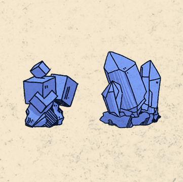

# Overview

Geoscience collections encompass sediments, soils, rocks, minerals, ores, meteorites and fossils. Together, these specimens preserve the geological heritage of their places of origin and document the history of the Earth and our solar system. 

Rocks, minerals and sediments provide insights into geological processes, past climates and environmental changes, while fossils reveal the evolution of life, past biodiversity and changing ecosystems over millions of years. These collections also document the occurrence and use of natural resources throughout human history, highlighting their importance for societies, economies and modern technologies. Meteorites offer unique insights into the formation and evolution of our solar system. 

As irreplaceable archives of Earth’s history, geoscience collections are essential resources for scientific research, understanding environmental change, conserving geological heritage, managing natural resources sustainably and inspiring education and public engagement.

# In Switzerland

Swiss institutions are estimated to hold several thousand meteorite specimens, more than one million rock, mineral and ore specimens and several million fossils from around the world. These collections also preserve important records of Switzerland’s geological heritage, including rock cores and samples collected during major Alpine tunnel construction projects. Such specimens provide unique insights into geological formations that would otherwise remain inaccessible. 

While the SwissNatColl portal provides a direct access to fossil specimen data, information on other geoscience collections is not yet available at specimen level. To fill this gap, the Swissgeol collections portal is currently under development, with a first showcase prototype expected soon.

    <a href="/collection/search?contentType=Minerals&contentType=Rocks&contentType=EarthPlanetary" style="text-decoration: none;" target="_blank">
      <button style="padding: 10px 20px; font-size: 24px; border: 2px solid white; border-radius: 4px; background-color: transparent; color: #333; cursor: pointer; display: flex; flex-direction: column; align-items: center; gap: 6px;"
              onmouseover="this.style.color='{{ site.data.colors.siteColor.background }}';"
              onmouseout="this.style.color='#333';">
        
        Earth sciences collections
      </button>
    </a>
    <!-- À remettre : href="LIEN" target="_blank" et retirer pointer-events: none -->
    <a style="text-decoration: none; pointer-events: none;">
      <button style="padding: 10px 40px; font-size: 24px; border: 2px solid white; border-radius: 4px; background-color: transparent; color: #333; cursor: default; display: flex; flex-direction: column; align-items: center; gap: 6px;">
        
        Swissgeol
      </button>
    </a>


